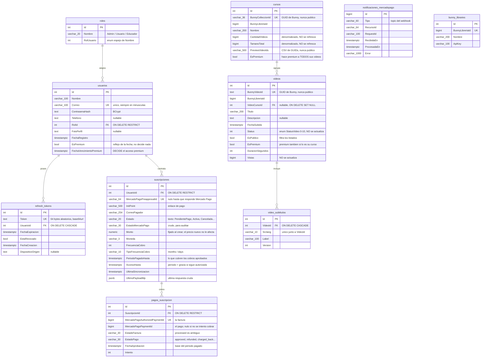

# Modelo de datos

PostgreSQL, gestionado con Entity Framework Core 8 mediante migraciones.
Las tablas van en `snake_case`; las columnas conservan el `PascalCase` de las
entidades y por eso hay que entrecomillarlas en SQL: `select "Correo" from usuarios`.

## Diagrama

## Índices

| Tabla | Índice | Tipo | Para qué |
|---|---|---|---|
| `usuarios` | `IX_usuarios_Correo` | **único** | Identidad de login. Es la garantía real contra cuentas duplicadas |
| `usuarios` | `IX_usuarios_RolId` | FK | Joins con `roles` |
| `refresh_tokens` | `IX_refresh_tokens_Token` | **único** | Búsqueda en cada refresh |
| `refresh_tokens` | `IX_refresh_tokens_UsuarioId_EstaRevocado` | compuesto | Revocación masiva al cambiar contraseña o correo |
| `refresh_tokens` | `IX_refresh_tokens_FechaExpiracion` | simple | Purga de tokens caducados |
| `suscripciones` | `IX_suscripciones_MercadoPagoPreapprovalId` | **único** | Una fila por suscripción de Mercado Pago (admite varios `NULL`) |
| `suscripciones` | `IX_suscripciones_UsuarioId_PendientePago` | **único parcial** | Como mucho **una** pendiente de pago por usuario |
| `suscripciones` | `IX_suscripciones_UsuarioId_Estado` | compuesto | "Suscripciones vivas de este usuario" |
| `pagos_suscripcion` | `IX_pagos_suscripcion_MercadoPagoAuthorizedPaymentId` | **único** | Un cobro se registra una vez, aunque lleguen webhooks duplicados |
| `pagos_suscripcion` | `IX_pagos_suscripcion_MercadoPagoPaymentId` | simple | Resolver webhooks `payment` (reembolsos, contracargos) |
| `notificaciones_mercadopago` | `IX_notificaciones_mercadopago_RecibidaEn` | simple | Purga a los 30 días |
| `videos` | `IX_videos_BunnyVideoId` | **único** | Un GUID de Bunny no puede repetirse |
| `videos` | `IX_videos_VideoCursoId` | FK | Listado por colección |
| `cursos` | `IX_cursos_BunnyColleccionId` | **único** | Igual, para colecciones |
| `video_subtitulos` | `IX_video_subtitulos_VideoId_Srclang` | **único** | Un idioma por video |
| `bunny_libraries` | `IX_bunny_libraries_BunnyLibreriaId` | **único** | Una fila por librería |

> El índice parcial solo cubre `PendientePago` **a propósito**. Si cubriera también `Activa`,
> una autorización real de Mercado Pago podría chocar con él al sincronizar y el cobro quedaría
> sin reflejarse: Mercado Pago cobra y el usuario no recibe acceso. Por eso `Estado` se guarda
> como texto: un filtro sobre números se rompería en silencio si alguien reordena el enum.

## Comportamiento de borrado

| Relación | Comportamiento | Consecuencia |
|---|---|---|
| `usuarios` → `roles` | `RESTRICT` | No se puede borrar un rol que alguien esté usando |
| `refresh_tokens` → `usuarios` | `CASCADE` | Borrar un usuario cierra sus sesiones |
| `suscripciones` → `usuarios` | `RESTRICT` | El historial de cobros no desaparece con el usuario |
| `pagos_suscripcion` → `suscripciones` | `RESTRICT` | Igual |
| `videos` → `cursos` | `SET NULL` | Borrar una colección **no** borra sus videos: quedan sueltos |
| `video_subtitulos` → `videos` | `CASCADE` | Borrar un video borra sus subtítulos |

`DELETE /api/usuarios/{id}` responde **409** si el usuario tiene una suscripción viva (Mercado
Pago le seguiría cobrando) o cobros registrados. Si solo tiene altas abandonadas sin ningún
cobro, las borra y después borra al usuario.

## Trampas del modelo

Cosas que el esquema no impide y conviene tener presentes.

### El acceso premium lo decide la fecha, no el flag

`usuarios.FechaVencimientoPremium` es la fuente de verdad: premium mientras sea posterior a
ahora. `usuarios.EsPremium` se mantiene por compatibilidad y se calcula a partir de la fecha;
el proceso en segundo plano lo pone a `false` al caducar, pero es cosmético.

**Poner `EsPremium = true` a mano ya no da acceso.** Para regalar premium hay que poner una
`FechaVencimientoPremium` futura (y la siguiente sincronización de una suscripción del usuario
la recalculará a partir de sus cobros).

### `Activa` no significa "tiene acceso"

Una suscripción `Activa` con el último cobro rechazado no da acceso pasada la gracia, y una
`Cancelada` conserva el acceso hasta el fin del periodo pagado. El acceso sale de las fechas,
nunca del estado. Ver [08-suscripciones.md](08-suscripciones.md).

### El precio de una suscripción se fija al crearla

`suscripciones.Monto` guarda el precio del momento del alta. Cambiar
`MercadoPago:PrecioMensual` solo afecta a las altas nuevas.

### `Rol` tiene doble fuente de verdad

`roles` guarda `Nombre` (string) y `RolUsuario` (enum), que dicen lo mismo.
**La autorización usa `Nombre`**: el claim del JWT sale de ahí y
`[Authorize(Roles = "Admin")]` compara contra esa cadena. El enum es conveniencia
de tipado. Unificarlos es un refactor pendiente; mientras tanto, la seed mantiene
los dos valores alineados.

### Los metadatos de video nunca se actualizan

`Status`, `ProgresoEncoding`, `DuracionSegundos`, `Ancho`, `Alto`, `Vistas`,
`AlmacenamientoTamano` y los campos de thumbnail se insertan en 0 o `null` al crear
el video y **no vuelven a cambiar**: Bunny los informa mediante un webhook que
todavía no está implementado. Lo mismo con `cursos.CantidadVideos` y `TamanoTotal`.

Consecuencia práctica: `GET /api/videos/{id}/estadisticas` devuelve ceros.

### `bunny_libraries` no tiene claves foráneas activas

La tabla existe, pero `videos.BunnyLibreriaId` y `cursos.BunnyLibreriaId` son
columnas planas sin FK hacia ella. Fue una decisión consciente ("Opción A" en el
`AppDbContext`) para no acoplar el modelo mientras haya una sola librería.
