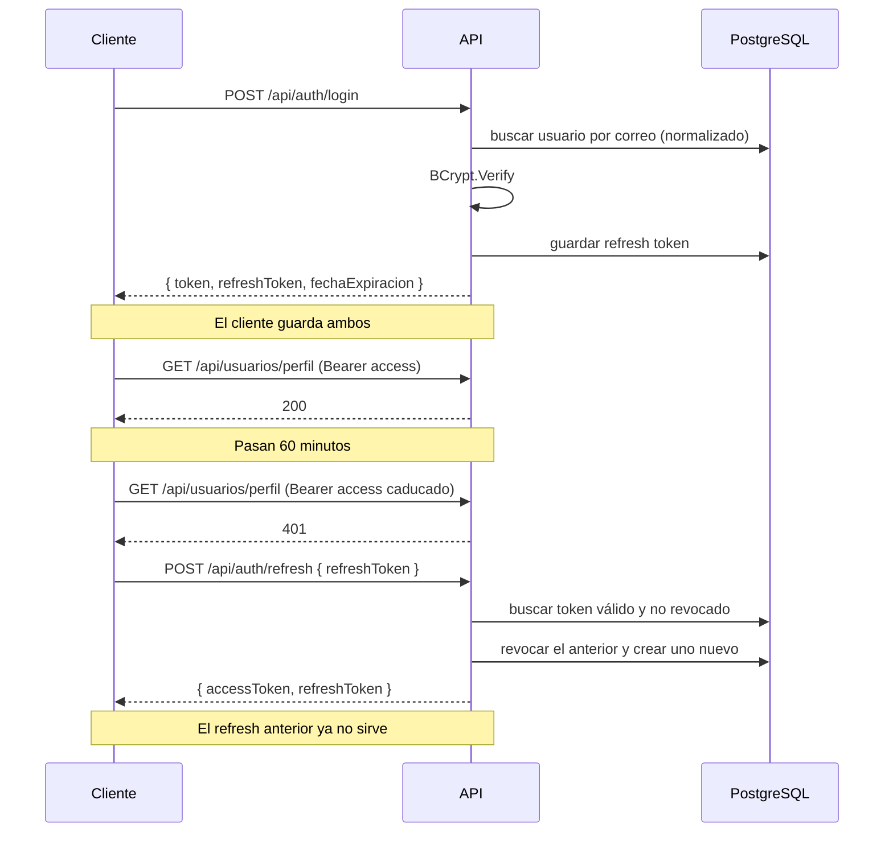

# Autenticación y autorización

Dos tokens: un **access token** JWT de vida corta que viaja en cada petición, y un
**refresh token** opaco de vida larga guardado en base de datos que sirve para
renovar el primero.

## Por qué dos tokens

El access token se valida con la firma, sin tocar la base de datos: es rápido pero
**no se puede revocar** antes de que expire. El refresh token sí vive en base de
datos, así que se puede invalidar al instante. La combinación da rendimiento en el
caso normal y capacidad de corte cuando hace falta.

El precio: **el rol y `esPremium` viajan dentro del access token**. Si degradas a un
administrador o le vence el premium, el token viejo sigue diciendo lo contrario hasta
60 minutos. Para cortar el acceso de inmediato hay que revocar los refresh tokens
*y* esperar a que caduque el access, o bajar `Jwt:AccessTokenMinutos`.

## El access token

Firmado con HMAC-SHA256. Vigencia por defecto: 60 minutos. `ClockSkew` en cero
(el valor por defecto de .NET son 5 minutos de gracia, demasiado laxo).

| Claim | Contenido |
|---|---|
| `sub` | Id del usuario |
| `email` | Correo |
| `name` | Nombre |
| `jti` | Identificador único del token |
| `role` | `Admin`, `Usuario` o `Educador` |
| `esPremium` | `true` / `false` |

> El handler de JWT de .NET **remapea `sub` a `ClaimTypes.NameIdentifier`** al leer
> el token. Por eso los helpers de los controllers buscan primero `NameIdentifier`
> y solo después `sub`. Si alguna vez se desactiva ese remapeo con
> `DefaultInboundClaimTypeMap.Clear()`, el segundo intento es el que salva.

## El refresh token

64 bytes de `RandomNumberGenerator` en base64 url-safe. Es **opaco**: no lleva
información, solo sirve para buscar la fila correspondiente. Vigencia: 7 días.

**Rota en cada uso.** Al llamar a `/refresh`, el token entregado se revoca y se
emite uno nuevo. Reutilizar uno ya gastado devuelve 401.

## Flujo

> Detalle incómodo del contrato: `/login` devuelve el campo **`token`** y `/refresh`
> devuelve **`accessToken`**. Son el mismo tipo de valor con distinto nombre.
> Está así por compatibilidad; unificarlo rompería a los clientes existentes.

## Cuándo se revocan los tokens

| Evento | Efecto |
|---|---|
| `POST /api/auth/refresh` | Revoca el token usado y emite uno nuevo |
| `POST /api/auth/logout` | Revoca ese token, **solo si pertenece al usuario autenticado** |
| Cambiar la contraseña | Revoca **todos** los refresh tokens del usuario |
| Cambiar el correo | Revoca **todos** los refresh tokens del usuario |
| Eliminar el usuario | Se borran en cascada |

Logout devuelve 204 aunque el token no exista o sea de otro: distinguir los casos
permitiría averiguar qué tokens están activos.

## Login con Google

Se valida el `id_token` contra `Google:ClientId`. Dos condiciones adicionales:

- **Si `Google:ClientId` no está configurado, se rechaza.** Sin él la audiencia sería
  nula y no se comprobaría para qué aplicación se emitió el token.
- **Se exige `EmailVerified`.** Sin esa comprobación, alguien con una cuenta de Google
  no verificada sobre un correo ajeno podría apoderarse de una cuenta ya registrada
  con ese mismo correo.

Si el correo ya existe, se vincula a la cuenta existente y se actualiza la foto.

## Contraseñas

BCrypt con el factor de trabajo por defecto de la librería. Requisitos: mínimo 6
caracteres con al menos una mayúscula, una minúscula y un número.

Los correos se **normalizan** (`trim` + minúsculas) antes de comparar y antes de
guardar, mediante `Utils/NormalizadorCorreo`. El índice único de `usuarios.Correo`
es la garantía de último recurso: si dos peticiones simultáneas superan la validación
en código, la base de datos rechaza la segunda y la API responde 409.

## Rate limiting

Particionado por IP, en memoria.

| Política | Endpoints | Límite |
|---|---|---|
| global | los 26 endpoints | 150 por minuto |
| `auth` | `/login`, `/login-google`, `/refresh` | 8 por minuto |
| `registro` | `/registro` | 5 por hora |
| `sensible` | `/cambiar-password` | 5 por minuto |
| `escritura` | POST/PUT/DELETE de Admin | 30 por minuto |

Al superarlo: `429` con cabecera `Retry-After` y el formato de error estándar.

`/cambiar-password` tiene política propia porque gasta ~200 ms de BCrypt por llamada
(verify + hash) y **el verify se ejecuta antes de rechazar**: un bucle con la contraseña
equivocada ya quema CPU.

> **De dónde sale la IP importa.** Si se confía en `X-Forwarded-For` sin restricciones,
> el límite se salta mandando una IP distinta en cada petición. Por defecto la API
> **no** procesa cabeceras reenviadas y usa la IP real de la conexión. Ver
> [07-limites-y-abuso.md](07-limites-y-abuso.md).

Limitación conocida: el limitador es **en memoria**. Con varias réplicas, el límite
efectivo se multiplica por el número de instancias.

## Roles

| Id | Nombre | Uso |
|---|---|---|
| 1 | `Admin` | Gestión de usuarios, videos y cursos |
| 2 | `Usuario` | Rol por defecto al registrarse |
| 3 | `Educador` | Sembrado, sin permisos propios todavía |

El registro siempre crea usuarios con rol `Usuario`. Solo un `Admin` puede cambiar
roles, mediante `PUT /api/usuarios/{id}`, y el `rolId` se valida contra la tabla
antes de asignarlo.
