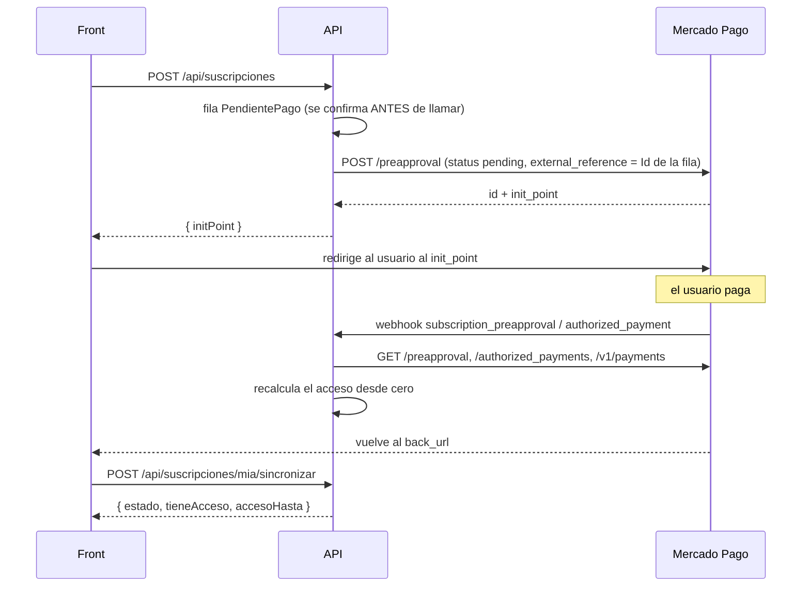

# Suscripciones con Mercado Pago

Mensualidad para ver videos premium. Los videos no premium son gratuitos; un **curso
premium hace premium a todos sus videos**, aunque cada video individual diga lo contrario.

| Decisión | Valor |
|---|---|
| País y moneda | México, MXN |
| Cómo paga el usuario | Redirección a Mercado Pago. La API **nunca** toca datos de tarjeta |
| Precio | `MercadoPago:PrecioMensual`. Cambiarlo no afecta a quien ya está suscrito |
| Prueba gratis | No |
| Acceso antes del primer cobro | Ninguno: solo con un cobro **aprobado** |
| Gracia tras un cobro fallido | 3 días, solo mientras la suscripción siga autorizada |
| Al cancelar | Conserva el acceso hasta el fin del periodo pagado, **sin reembolso** |

---

## Flujo



Se usa la suscripción **sin plan** de Mercado Pago (`POST /preapproval` con
`status: "pending"`). El modelo con plan exige tokenizar la tarjeta en el front, que es
incompatible con la redirección.

---

## De qué depende el acceso

Premium = `esAdmin || usuario.FechaVencimientoPremium > ahora`.

Se decide **por fecha, no por el flag `EsPremium`**: el acceso caduca solo, sin depender de
que corra ningún proceso. `EsPremium` se sigue devolviendo en los DTOs, pero calculado a partir
de esa fecha.

La fecha se recalcula **desde cero** en cada sincronización, a partir del estado *actual* de
los cobros en Mercado Pago:

```
PeriodoPagadoHasta = máx(fecha de aprobación + periodo)   solo pagos que HOY siguen "approved"
AccesoHasta        = PeriodoPagadoHasta + 3 días          la gracia solo si sigue "authorized"
FechaVencimientoPremium = máx(AccesoHasta) de todas sus suscripciones
```

Consecuencias, todas verificadas:

- **Un reembolso o contracargo recorta el acceso** en cuanto se detecta.
- **Quien cancela conserva lo pagado pero no se lleva la gracia.**
- Un reintento que sale aprobado días después **desplaza** el periodo a favor del usuario;
  dos meses pagados no se acumulan más allá de lo que cubren.
- El resultado es el mismo lleguen los webhooks en el orden que lleguen, repetidos o
  falsificados: nunca se cree lo que dice la notificación.

> **El claim `esPremium` del JWT puede ir hasta 60 minutos desfasado.** Es informativo para el
> front; nadie lo usa para autorizar. El control de acceso lee la base de datos en cada petición.

---

## Estados

| Local | En Mercado Pago | Significado |
|---|---|---|
| `PendientePago` | `pending` | Creada; el usuario aún no pagó |
| `Activa` | `authorized` | Cobra cada periodo. **No implica acceso**: el cobro puede haber fallado |
| `Pausada` | `paused` | Se puede reanudar desde Mercado Pago |
| `Suspendida` | `suspended` | Suspendida por Mercado Pago |
| `Cancelada` | `cancelled` | Conserva el acceso hasta fin del periodo pagado |
| `Abandonada` | `cancelled` | Pendiente que nadie pagó a tiempo; la canceló el sistema |
| `ErrorCreacion` | — | Mercado Pago nunca la creó, o no se pudo recuperar |

No existe "Vencida": que el acceso haya caducado se deduce de las fechas.
El estado se guarda **como texto** en la base de datos.

---

## Endpoints

| Método | Ruta | Auth | Límite |
|---|---|---|---|
| POST | `/api/suscripciones` | JWT | `sensible` |
| GET | `/api/suscripciones/mia` | JWT | global |
| POST | `/api/suscripciones/mia/cancelar` | JWT | `sensible` |
| POST | `/api/suscripciones/mia/sincronizar` | JWT | `sensible` |
| GET | `/api/suscripciones/admin` | Admin | global |
| POST | `/api/suscripciones/admin/{id}/sincronizar` | Admin | `escritura` |
| POST | `/api/webhooks/mercadopago` | **firma** | **ninguno** |

### POST `/api/suscripciones`

Cuerpo opcional: `{ "correoMercadoPago": "..." }`. Si no se envía, se usa el correo de la
cuenta. Existe porque Mercado Pago puede exigir que coincida con quien paga.

**200** → `{ "suscripcionId": 12, "initPoint": "https://www.mercadopago.com.mx/subscriptions/checkout?preapproval_id=...", "estado": "PendientePago" }`

- Si ya tiene una pendiente reciente con el mismo correo, **devuelve la misma**.
- Antes de crear una nueva, **cancela en Mercado Pago** cualquier pendiente, pausada o
  suspendida anterior: un enlace de pago viejo sigue siendo pagable.
- **409** si ya tiene una `Activa`.
- **502** si Mercado Pago falla o no está configurado.

### GET `/api/suscripciones/mia`

```json
{
  "suscripcionId": 12,
  "estado": "Activa",
  "tieneAcceso": true,
  "accesoHasta": "2026-10-16T00:41:49+00:00",
  "periodoPagadoHasta": "2026-10-13T00:41:49+00:00",
  "fechaProximoCobro": "2026-10-12T20:41:49+00:00",
  "monto": 99, "moneda": "MXN",
  "primerCobroPendiente": false,
  "canceladaConAccesoVigente": false
}
```

`primerCobroPendiente: true` → la interfaz debería mostrar "procesando tu pago".
Sin suscripción, `estado` es `"SinSuscripcion"`.

### POST `/api/suscripciones/mia/cancelar`

Cancela en Mercado Pago y **solo la marca como cancelada cuando una lectura posterior lo
confirma**. Si no, responde 502 y no cambia nada: marcarla como cancelada sin confirmarlo
haría que la interfaz dijera "cancelada" mientras Mercado Pago sigue cobrando.

### POST `/api/suscripciones/mia/sincronizar`

Relee de Mercado Pago. **El front lo llama al volver del pago.** Los parámetros que Mercado
Pago añade al `back_url` no están documentados, así que la API no los usa.

---

## Webhook

URL: `https://<tu-dominio>/api/webhooks/mercadopago`. **Se configura en el panel** de
Mercado Pago (Tus integraciones → Webhooks) con los topics de suscripciones y de pagos;
el campo `notification_url` no está disponible para suscripciones.

| Topic | Qué hace |
|---|---|
| `subscription_preapproval` | Sincroniza esa suscripción |
| `subscription_authorized_payment` | Sincroniza la suscripción del cobro |
| `payment` | Si es cobro de una suscripción, la sincroniza (reembolsos, contracargos). Si no, se ignora |
| cualquier otro | 200 y se ignora |

Reglas:

- **La firma se valida antes de cualquier acceso a base de datos o a la red.** Sin firma o
  inválida → 401, y no queda rastro en la base.
- Manifiesto firmado: `id:{data.id};request-id:{x-request-id};ts:{ts};`, con `data.id` del
  query, en minúsculas si es alfanumérico, y omitiendo las partes ausentes.
  HMAC-SHA256 en hexadecimal con `MercadoPago:WebhookSecret`.
- No se comprueba la antigüedad de `ts`: los reintentos de Mercado Pago lo reutilizan. Reenviar
  un webhook válido es inocuo porque siempre se relee el estado de Mercado Pago.
- **Excluido de todo rate limiting**, incluido el global: con un túnel o un proxy todas las
  peticiones llegarían desde la misma IP. La barrera es la firma. Verificado: 160 peticiones
  seguidas → 160 respuestas 401, ninguna 429.
- Presupuesto de 15 s (Mercado Pago espera respuesta en menos de 22). 200 si se procesó; **500
  ante un fallo transitorio**, para que Mercado Pago reintente cada 15 minutos.
- Antirrebote: si **la misma** notificación (tipo + id) se procesó hace menos de 30 s, 200 sin
  volver a Mercado Pago. No se usa "esta suscripción se sincronizó hace poco": se saltaría el
  aviso del cobro que llega justo después del de la autorización.

Cada notificación válida queda en `notificaciones_mercadopago` para auditoría; se purgan a
los 30 días.

---

## Concurrencia

Alta, cancelación y sincronización toman un **candado por usuario en PostgreSQL**
(`pg_advisory_xact_lock`). Evita que una lectura antigua de Mercado Pago pise a una reciente y
que dos procesos registren el mismo cobro. Funciona aunque haya varias instancias de la API.

Además:

- **Índice único parcial**: como mucho una suscripción `PendientePago` por usuario. Solo cubre
  ese estado a propósito; si cubriera `Activa`, una autorización real de Mercado Pago podría
  chocar con el índice y el cobro quedaría sin reflejarse.
- **Clave de idempotencia fija por fila** (`suscripcion-{Id}`): un reintento tras un timeout no
  crea un segundo preapproval.
- **La fila nunca se borra**: se crea antes de llamar a Mercado Pago, así que un webhook que
  llegue antes de guardar el id del preapproval se resuelve por `external_reference`.
- Si aparecieran dos suscripciones autorizadas a la vez para un usuario (cobro doble), se
  cancela la que no tenga cobros aprobados y se registra un log `Critical`. Si ambas tienen
  cobros, solo se avisa: esa decisión es humana.

Verificado: 10 webhooks idénticos en paralelo → ningún error y un único cobro registrado.

---

## Proceso en segundo plano

`ConciliacionSuscripcionesService`, cada hora (la primera pasada al minuto de arrancar):

1. **Abandona las pendientes** de más de `HorasCaducidadPendiente` (24 h): las cancela en
   Mercado Pago para que su enlace deje de ser pagable. Antes las refresca: si el usuario
   pagó a última hora, ya estarán autorizadas y no se tocan.
2. **Resincroniza** las vivas, con prioridad a las cercanas a su fecha de cobro y a las que
   llevan más de 24 h sin sincronizar. Recupera webhooks perdidos.
3. Pone `EsPremium = false` a quien ya caducó (cosmético: el acceso va por fecha).
4. Purga notificaciones de más de 30 días.

**El acceso no depende de este proceso.** Si no corriera, solo se perdería la recuperación de
webhooks perdidos.

---

## Usuarios con suscripción

Borrar un usuario:

- con una suscripción **viva** (pendiente, activa, pausada o suspendida) → **409**. Si no,
  Mercado Pago le seguiría cobrando cada mes a alguien sin cuenta;
- con **cobros registrados** → **409**: el historial de pagos se conserva;
- con solo altas abandonadas o fallidas, sin ningún cobro → se borran esas filas y el usuario.

---

## Configuración

| Clave | Por defecto | Notas |
|---|---|---|
| `MercadoPago:AccessToken` | — | Del **vendedor**. Fuera de Development se rechaza uno `TEST-` |
| `MercadoPago:WebhookSecret` | — | Panel → Tus integraciones → Webhooks |
| `MercadoPago:BackUrl` | — | https. Mercado Pago rechaza `localhost` |
| `MercadoPago:PrecioMensual` | 99 | No cambia suscripciones existentes |
| `MercadoPago:Moneda` | MXN | |
| `MercadoPago:DiasGracia` | 3 | |
| `MercadoPago:PeriodoFrecuencia` / `TipoFrecuencia` | 1 / `months` | Solo modificables en Development (probar renovaciones con `days`) |
| `MercadoPago:HorasCaducidadPendiente` | 24 | |
| `MercadoPago:AccesoProvisionalHoras` | 0 | Acceso antes del primer cobro. 0 = ninguno |
| `MercadoPago:ApiBaseUrl` | `https://api.mercadopago.com` | Se apunta a un servidor falso para pruebas |

Fuera de Development es **obligatorio**: la API no arranca sin él. En Development es opcional:
el alta responde 502 con un mensaje claro y el resto de la API funciona.

En Docker: `MP_ACCESS_TOKEN`, `MP_WEBHOOK_SECRET`, `MP_PRECIO_MENSUAL`, `MP_BACK_URL` en el
`.env`. Como el compose arranca en Production, **con credenciales de prueba hay que poner
`ASPNETCORE_ENVIRONMENT=Development`**.

---

## Cómo se ha probado

**Tests unitarios** (`tests/SergioApi.Tests`, 56 casos): validación de la firma, cálculo del
acceso (reembolso, contracargo, reintento, cancelación sin gracia, 31 de enero, fechas con
offset) y mapeo de estados.

```bash
dotnet test tests/SergioApi.Tests/SergioApi.Tests.csproj
```

**Extremo a extremo contra un Mercado Pago falso**: un servidor local que imita los endpoints
que usa la API, con `MercadoPago:ApiBaseUrl` apuntando a él. Se comprobó el flujo completo:
alta, reutilización de la pendiente, firma, pago, acceso, duplicados en paralelo, 409 al
borrar, cancelación, reembolso, resuscripción y abandono por el proceso en segundo plano.

> Eso verifica la **lógica de la API**, no el contrato real de Mercado Pago. Para eso está la
> Fase 0 de abajo.

---

## Pendiente: Fase 0 en el sandbox

Mercado Pago **no documenta** varias cosas de las que depende el código. Se construyó a la
defensiva, pero hay que confirmarlas contra el sandbox antes de cobrar de verdad:

| Por confirmar | Dónde afecta |
|---|---|
| ¿El primer cobro del flujo por redirección es inmediato? | Cuánto tiempo ve el usuario "procesando tu pago" |
| ¿Acepta un `start_date` futuro? | Resuscribirse sin cobrar días ya pagados (`SuscripcionService.ConstruirSolicitudAsync`) |
| `cancelled` o `canceled` al cancelar | `SincronizadorSuscripciones.EstadoCancelacionMp` |
| ¿Un `init_point` cancelado sigue siendo pagable? | Riesgo de cobro doble con enlaces viejos |
| Nombres de los parámetros de búsqueda (`external_reference`, `preapproval_id`) | `MercadoPagoClient` |
| Campos reales de `authorized_payment` y `payment` | `Models/MercadoPago/MercadoPagoDtos.cs` |
| ¿Respeta `X-Idempotency-Key` en `/preapproval`? | Recuperación de altas cortadas por timeout |
| ¿`payer_email` debe coincidir con quien paga? | El campo opcional `correoMercadoPago` |
| Monto mínimo en MXN | `MercadoPago:PrecioMensual` |
| Una notificación real completa (cabeceras, query, cuerpo) | Añadirla como fixture al test de firma |

### Pasos

1. En el panel de Mercado Pago, **Cuentas de prueba**: crear un **vendedor** y un
   **comprador**, ambos de México.
2. Usar el Access Token de prueba **del vendedor**. Si aparece "Both payer and collector must
   be real or test users", crear la aplicación iniciando sesión con el vendedor de prueba y
   usar sus credenciales.
3. Arrancar la API en local con el perfil `http` (con `https`, la redirección a HTTPS devolvería
   307 al POST de Mercado Pago):

   ```bash
   dotnet user-secrets set "MercadoPago:AccessToken" "TEST-..."
   dotnet user-secrets set "MercadoPago:WebhookSecret" "..."
   dotnet user-secrets set "MercadoPago:BackUrl" "https://..."
   dotnet run --launch-profile http
   ```

4. Exponerla con un túnel y poner su URL en el panel como webhook:

   ```bash
   sudo dnf install -y https://github.com/cloudflare/cloudflared/releases/latest/download/cloudflared-linux-x86_64.rpm
   cloudflared tunnel --url http://localhost:5094
   ```

   La URL `*.trycloudflare.com` **cambia en cada arranque**: hay que actualizarla en el panel.

5. `POST /api/suscripciones` con `correoMercadoPago` = correo del comprador de prueba. Abrir el
   `initPoint` en una ventana de incógnito, iniciar sesión como el comprador y pagar con una
   tarjeta de prueba de México con titular **`APRO`** (aprobado) u **`OTHE`** (rechazado).
6. Comprobar el log de la API, `GET /api/suscripciones/mia` y `notificaciones_mercadopago`.

La comunidad reporta que el sandbox de suscripciones en México es inestable. Si el checkout de
prueba falla sin motivo, puede hacer falta validar con un monto mínimo en producción controlada.

---

## Pendientes conocidos

- **Resuscribirse con acceso vigente** intenta programar el primer cobro al acabar el periodo
  pagado. Si el sandbox no acepta un `start_date` futuro, habrá que avisar en la interfaz de que
  se cobrarán días solapados.
- **Dos preapprovals para una misma fila** (no debería ocurrir con la clave de idempotencia) se
  registran como `Critical` pero no se resuelven solos.
- El candado por usuario mantiene una transacción abierta durante las llamadas a Mercado Pago
  (unos segundos). Aceptable a este volumen; con mucho tráfico convendría una cola.
- El proceso en segundo plano corre en cada instancia. El candado evita daños, pero con varias
  réplicas hace trabajo repetido.
